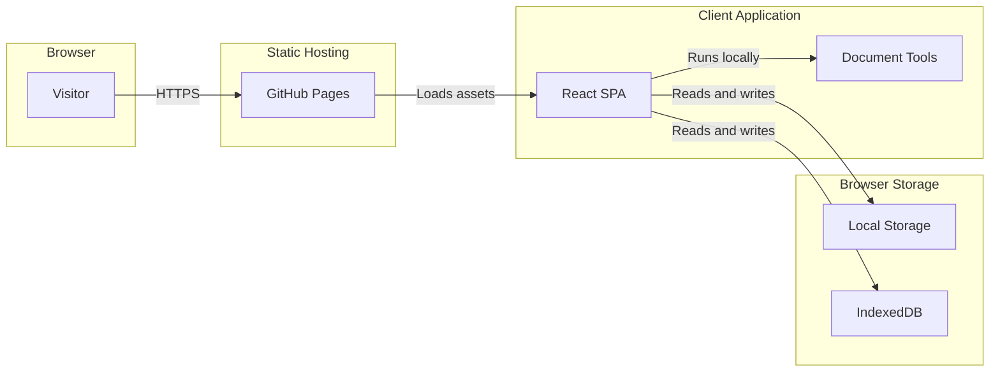
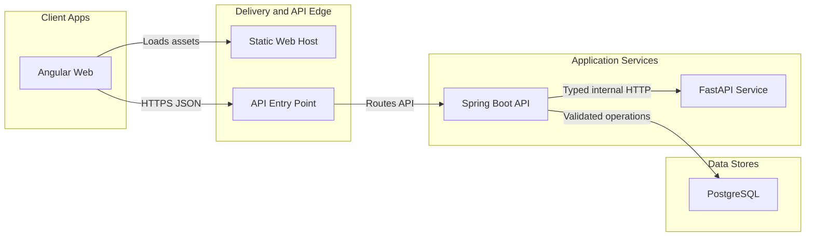

# Repository Audit

Audit date: 2026-10-23  
Repository: `professionaldev`  
Branch: `main` (tracking `origin/main`)  
Starting worktree: clean  
Most recent commit: `5b67a16fbd804e6860904ab94ae40425249b0e94` — “Update professionaldev website” (2026-04-04)

## Executive summary

This repository is currently a client-only React 18 single-page application built with Vite 7 and TypeScript. It is not Angular, Next.js, a backend application, or a monorepo. It has 115 tracked files before this audit, 99 tracked TypeScript/TSX/CSS files, and approximately 10,610 source lines. The site stores user work in the browser and deploys static assets to GitHub Pages.

Milestone 2 resolved the original TypeScript, CI runtime, destructive migration, eager-route, testing, linting, and package-manager findings. The repository now passes its quality pipeline with npm and Node 22. Remaining concerns are documented in the cleanup report, including five moderate full-tree npm advisories that require breaking React Router or Tailwind migrations.

The safest strategy is to stabilize and test the React application first. Spring Boot, PostgreSQL, Angular, and FastAPI should be introduced in separate, validated milestones rather than by moving or rewriting the current site immediately.

## Current technology stack

| Area | Current implementation | Evidence |
| --- | --- | --- |
| UI | React 18.3.1 with TypeScript | `src/main.tsx`, `package.json` |
| Routing | React Router 6 with `BrowserRouter` and Vite base URL | `src/main.tsx`, `src/App.tsx` |
| Build | Vite 7.1.x, TypeScript 5.9, React plugin | `vite.config.ts`, lockfiles |
| Styling | Tailwind CSS 3, PostCSS, Autoprefixer, global semantic CSS | `tailwind.config.js`, `src/styles/tailwind.css` |
| Icons/visuals | Lucide; Three.js and React Three Fiber are present | imports and `package.json` |
| Documents | PDF.js and Mammoth parse resumes; html2canvas/jsPDF export content | `src/utils`, page imports |
| Persistence | `localStorage` and IndexedDB; no remote database | hooks, settings, feature pages |
| Backend/API | None | no server source, API client, or network request layer |
| Tests | Vitest unit tests and Playwright browser tests | `tests/`, test configuration, npm scripts |
| Lint/format | ESLint flat configuration | `eslint.config.js`, `npm run lint` |
| Deployment | GitHub Pages via GitHub Actions; optional `gh-pages` script | `.github/workflows/deploy.yml`, `package.json` |
| Package manager | npm with one authoritative lockfile | `package-lock.json`, workflow, README |

The app has no secret-bearing environment variables. The only environment reference is Vite's generated `import.meta.env.BASE_URL`.

## Current request and data flow



There is no network API or server-side processing in the current code. Resume files are parsed in the browser. Microphone and camera tools use browser media APIs.

## Current tracked structure

Generated `dist/` output and installed `node_modules/` are present locally but correctly ignored by Git.

```text
professionaldev/
├── .github/
│   └── workflows/deploy.yml
├── .vscode/settings.json
├── docs/                         # added by this audit
│   ├── architecture/
│   └── learning/
├── src/
│   ├── App.tsx                   # route table with lazy page imports
│   ├── main.tsx                  # browser entry point
│   ├── components/
│   │   ├── Elevator/TeleprompterRecorder.tsx
│   │   ├── backgrounds/          # five alternate background implementations
│   │   ├── chat/PDCoach.tsx
│   │   ├── home/                 # nine home-section components
│   │   ├── shell/                # active background and footer
│   │   ├── ui/                   # active and legacy UI primitives
│   │   └── fourteen top-level component files
│   ├── data/
│   │   ├── resources/            # break ideas and certification data
│   │   ├── self/                 # values, interests, strengths questions
│   │   └── siteContact.ts
│   ├── hooks/                    # local persistence and media recording
│   ├── pages/
│   │   ├── CareerTools/          # 12 pages
│   │   ├── Resources/            # 7 pages
│   │   ├── SelfAssessment/       # 7 pages
│   │   └── 8 top-level pages
│   ├── styles/tailwind.css
│   ├── theme/                    # provider, tokens, design-system metadata
│   └── utils/                    # resume analysis, extraction, storage, migration
├── tests/
│   ├── e2e/app.spec.ts
│   ├── unit/                     # migrations, storage, resume analysis
│   └── setup.ts
├── 404.html
├── README.md
├── README_DEPLOY.md
├── index.html
├── package.json
├── package-lock.json
├── eslint.config.js
├── playwright.config.ts
├── postcss.config.js
├── tailwind.config.js
├── tsconfig.json
├── vite.config.ts
├── vitest.config.ts
└── vite.svg
```

The complete tracked inventory can always be reproduced with `git ls-files`; this audit reviewed that list rather than assuming a framework from folder names.

## Routing and public URLs

`src/App.tsx` defines 34 route entries. The home page and application shell load eagerly; other page modules use `React.lazy` behind a shared `Suspense` boundary.

- Primary areas: `/`, `/about`, `/contact`, `/settings`, `/tech-career-hub`.
- Self assessment: `/self-assessment/*` plus newer `/self/*` paths.
- Career tools: mostly `/career-tools/*`, with two `/career/*` paths.
- Resources: `/resources/*`.
- Compatibility aliases exist for `/Resources/Certs` and `/Resources/JobSites`.
- There is no catch-all/not-found route.
- One internal link in `StrengthsTest.tsx` uses a plain absolute `<a href="/resources/roadmaps">`. On the configured GitHub Pages subpath this bypasses the router basename and can navigate to the wrong origin path.
- `404.html` redirects deep links to a hash form while the application uses `BrowserRouter`, and the build script overwrites `dist/404.html` with `dist/index.html`. The root redirect file therefore is not the file deployed by the npm build. This should be simplified only after testing direct-link behavior on the configured custom domain and GitHub Pages fallback URL.

## Architectural weaknesses

1. **Quality gate added.** Vite still transpiles without semantic type-checking, but CI now runs ESLint, `tsc`, Vitest, the production build, and Playwright independently.
2. **Route loading improved.** Route-level lazy loading reduced the minified entry JavaScript from 2,074.11 kB to 215.69 kB. Total generated JavaScript increased because patched PDF dependencies are now correctly bundled into on-demand chunks rather than left as ignored bare imports.
3. **Large page modules.** Several pages exceed 10 kB, with `Trackers.tsx` near 29 kB. UI, persistence, export behavior, and domain calculations are often combined in one component.
4. **Inconsistent organization.** Shared components exist at both `components/` and `components/ui/`; three separate `Card` concepts and two `Badge` components exist.
5. **Legacy/unreachable clusters.** Static import tracing from `main.tsx` found 31 TypeScript/TSX files outside the active graph. Some are isolated files; others are coherent experimental component sets and must not be bulk-deleted without visual/manual review.
6. **No typed boundary for future services.** There is currently no API client, DTO layer, server validation, or authentication boundary—which is appropriate for a client-only app but must change before server features are added.
7. **Persistence is scattered.** Storage keys and JSON parsing appear across pages, hooks, utilities, and the theme provider. Schema versions and consistent validation are absent.
8. **Deployment identity is ambiguous.** The README links to the GitHub Pages application while contact data points to `https://eskinder.dev/`. A live check on 2026-10-23 returned the title “Roadmap to Role” for the GitHub Pages URL and “Portfolio” for the custom-domain root, suggesting they are currently distinct public experiences.

## Duplicate, obsolete, and unreachable code

The following observations are based on static imports from `src/main.tsx`, repository-wide text searches, route definitions, scripts, and deployment configuration. “Unreachable” does not prove “unwanted.”

- Conclusively obsolete support artifacts removed in this audit: `src/ADD_TO_App_tsx_ROUTES.txt`, unused `src/index.css`, and duplicate `vite.config.ts.example`.
- Alternate shell components: `AppHeader.tsx` and `Footer.tsx` versus active `NavBar.tsx` and `shell/SiteFooter.tsx`.
- Duplicate primitives: `components/Card.tsx`, `components/ui/Card.tsx`, premium card variants; `components/Badge.tsx` and `components/ui/Badge.tsx`.
- Alternate background systems: `AnimatedBackground`, `Background3D`/`R3FScene`, `backgrounds/*`, and the active `shell/SiteBackground`.
- Alternate home concepts: `CircularOrbitHero`, `RoadmapPath`, and `ThreeTrackHero` are not in the active import graph.
- `CertsLearning.tsx` and `data/resources/certs.ts` form an un-routed feature pair.
- `theme/index.ts`, `theme/designSystem.ts`, and `theme/tokens.ts` are not reached by the app; `theme/cardTokens.ts` is active.
- `components/ui/motion.ts` imports `framer-motion`, which is not a direct dependency. It currently works only because the file is not imported and the package is available transitively.

See `cleanup-report.md` for the safety classification and disposition of each group.

## Dependency review

### Used by active application paths

React, React DOM, React Router, Lucide, Three.js, html2canvas, jsPDF, Mammoth, and PDF.js have source references in the active graph. Tailwind, PostCSS, Autoprefixer, TypeScript, Vite, its React plugin, `shx`, and `gh-pages` support building or deployment.

### No repository source or configuration references

- `dayjs`
- `idb-keyval`
- `papaparse`
- `recharts`

These four dependencies were removed with npm during Milestone 2 after repository-wide reference checks. The npm lockfile is now authoritative.

### Used only by an unreachable feature cluster

- `@react-three/drei` and `@react-three/fiber` are referenced by `R3FScene.tsx`.

Do not remove these packages until deciding whether the alternate 3D background is retained.

## Tests and verification baseline

| Check | Result |
| --- | --- |
| `npm.cmd run build` | Passed using Node 22.18.0 and Vite 7.3.7; the lazy Resume Grader/PDF.js chunk remains larger than 500 kB |
| `npm.cmd run typecheck` | Passed |
| `npm.cmd run test` | Passed: 3 files, 8 tests |
| `npm.cmd run lint` | Passed with no warnings |
| `npm.cmd run test:e2e` | Passed: 8 desktop/mobile Chromium executions |
| `npm.cmd audit --omit=dev` | Reports 2 moderate React Router advisories whose automatic fix requires React Router 7 |
| Full `npm.cmd audit` | Reports 5 moderate advisories; the additional development findings require Tailwind 4 |

Resolved TypeScript findings:

- `PDCoach.tsx`: inferred message roles widen to `string` rather than the `Msg` union.
- `main.tsx`: Vite client types are not included, so `ImportMeta.env` is unknown.
- `InterviewSim.tsx`: calls `rec.stop()` with an argument although the hook accepts none.

## Deployment findings

- GitHub Actions now builds and tests on Node 22, satisfying Vite and Vitest engine requirements.
- The workflow correctly uses `npm ci`, least-privilege Pages permissions, an uploaded Pages artifact, and deployment concurrency.
- The workflow separately copies `dist/index.html` to `dist/404.html`, although the npm build already does the same copy.
- `gh-pages` supports a second deployment method, but mixing branch deployment with the Pages Actions workflow should be avoided.
- The Vite base is fixed at `/professionaldev/`. Confirm whether the live custom domain is configured with the repository subpath or root hosting before changing it.
- A read-only live check reached `https://eskinder185.github.io/professionaldev/` as “Roadmap to Role” and `https://eskinder.dev/` as “Portfolio.” Nested direct URLs were not accessible to the audit client, so browser-based refresh testing remains necessary before changing routing or deployment settings.

## Security and data-safety review

- No committed `.env` file or obvious secret reference was found. `.env` is ignored.
- No `dangerouslySetInnerHTML` or raw HTML injection was found.
- External links generally include `rel="noreferrer"` or `noopener noreferrer` when opening a new tab.
- Resume and document processing is currently local to the browser; that privacy property should be made explicit to users and preserved unless a server upload is intentionally introduced.
- `runMigrations()` is versioned and idempotent. Version 1 preserves the historically targeted keys and creates an exact raw-value backup before recording success.
- JSON read/write logic is inconsistent. Some reads recover from malformed storage while others do not validate the parsed shape.
- If the un-routed certification learning page is activated, user-entered external URLs should be restricted to safe `http:`/`https:` schemes before rendering them as links.
- There is no Content Security Policy documented for the static deployment.

## Recommended target architecture

The target is a gradual monorepo. Directory creation should happen only when its milestone begins.

```text
developer-portfolio/
├── apps/
│   ├── legacy-web/               # current React app during migration only
│   ├── web/                      # Angular standalone application
│   ├── api/                      # Spring Boot/Maven modular monolith
│   └── ai-service/               # FastAPI, only for justified Python/AI work
├── infra/
│   ├── docker/
│   └── deployment/
├── docs/
│   ├── api/
│   ├── architecture/
│   └── learning/
├── .github/workflows/
├── .env.example                  # names and safe examples only
├── .gitignore
└── README.md
```



### Boundary decisions

- **Angular owns browser UI and reactive forms.** It should not contain database logic or secrets.
- **Spring Boot is the system-of-record API.** Start as a modular monolith with feature packages, DTOs, validation, explicit mapping, Flyway, PostgreSQL, security, and centralized errors.
- **FastAPI is optional and isolated.** Introduce it only when a real Python-specific capability exists. Spring Boot remains the public orchestration boundary unless a use case proves otherwise.
- **PostgreSQL stores durable server data.** Browser storage may remain for drafts and preferences, with schemas and migrations.
- **Contracts are explicit.** OpenAPI should describe HTTP contracts; do not share framework-internal models across applications.

## Decision record

Milestone 2 stabilization is complete. The recommended next milestone is a deliberately small Spring Boot API foundation, while React Router 7 and Tailwind 4 remain separately planned maintenance changes rather than forced upgrades inside this stabilization work.
